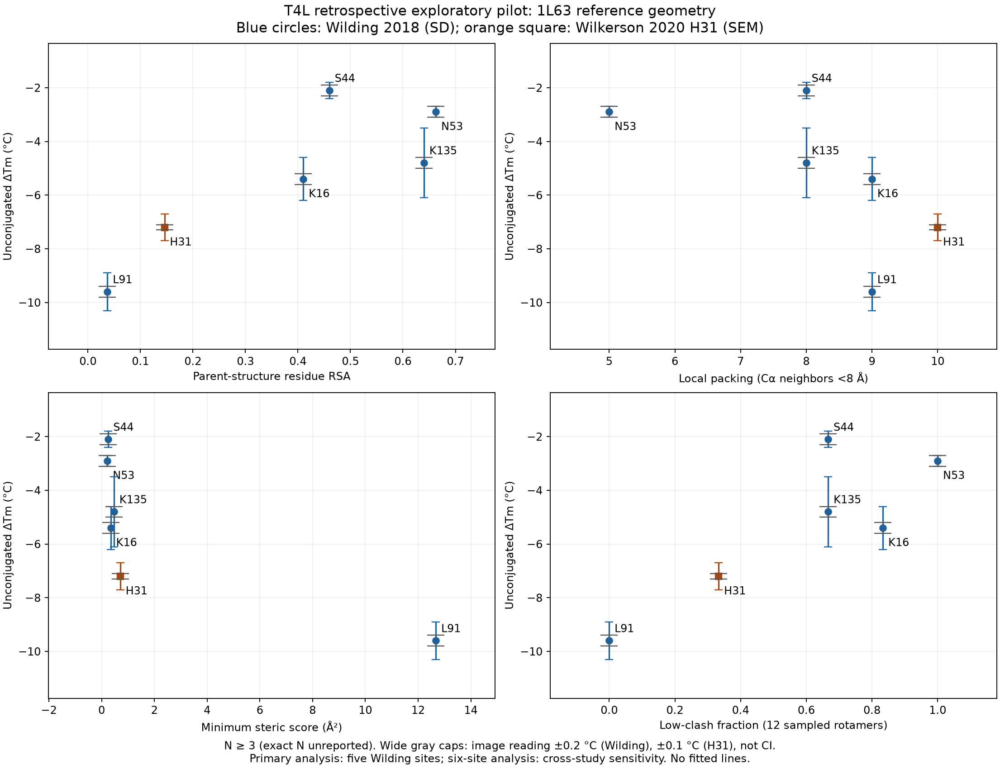
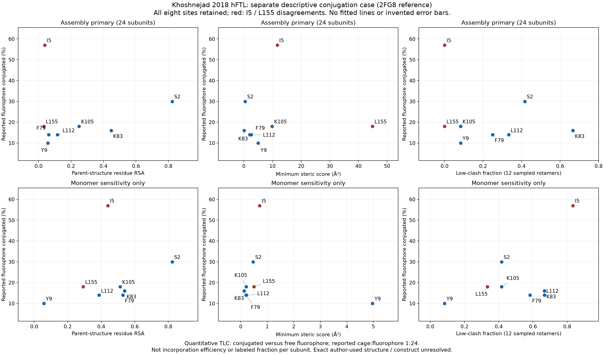

# Exploratory pilot results

Executed after the [evaluation plan](../evaluation_plan.md) was saved. Already-seen retrospective data; independent human digitization review **pending**. No scientific scoring changes.

## T4L: all four fields and both cohorts

Coefficients retain raw field direction. Direction hypotheses: positive RSA/fraction; negative packing/steric. No p-values or significance conclusions. Leave-one-out ranges use every possible omitted site and do not justify deleting any site.

| Cohort | Field | Sites | Spearman rho | Kendall tau-b | LOO rho range | LOO tau-b range |
| --- | --- | ---: | ---: | ---: | --- | --- |
| Wilding_primary | `rsa` | 5 | 0.700 | 0.600 | 0.400 to 1.000 | 0.333 to 1.000 |
| Wilding_primary | `ca_neighbors_8a` | 5 | -0.791 | -0.671 | -0.949 to -0.632 | -0.913 to -0.548 |
| Wilding_primary | `min_steric_score` | 5 | -0.800 | -0.600 | -0.800 to -0.600 | -0.667 to -0.333 |
| Wilding_primary | `low_clash_fraction` | 5 | 0.410 | 0.316 | -0.211 to 0.800 | -0.183 to 0.667 |
| six_site_cross_study_sensitivity | `rsa` | 6 | 0.829 | 0.733 | 0.700 to 1.000 | 0.600 to 1.000 |
| six_site_cross_study_sensitivity | `ca_neighbors_8a` | 6 | -0.794 | -0.645 | -0.821 to -0.718 | -0.738 to -0.527 |
| six_site_cross_study_sensitivity | `min_steric_score` | 6 | -0.886 | -0.733 | -0.900 to -0.800 | -0.800 to -0.600 |
| six_site_cross_study_sensitivity | `low_clash_fraction` | 6 | 0.667 | 0.552 | 0.410 to 0.900 | 0.316 to 0.800 |

All individual deletions, observation IDs, pair/tie counts, input hashes, versions and execution provenance are in [results.json](results.json). Spearman uses average ranks; tau-b retains ties. Rankings were not recomputed or combined.

Values and errors: frozen `t4l_stability_master.csv` fields `value`, `uncertainty_value`, `uncertainty_type`; exact row source locators and original PDF hashes remain there. Experimental SD (five Wilding sites) and SEM (H31) are distinct. Gray caps show operational reading bounds separately; they are not confidence intervals and are not added to SD/SEM. Bounds on extracted error lengths also remain in the frozen CSV. N >= 3 remains a lower bound.

The frozen means are K16 −5.4, S44 −2.1, N53 −2.9, L91 −9.6, K135 −4.8 and H31 −7.2 °C. These are digitized estimates, not exact published text values. No current strict sequence-matched eligibility is established. The shared scaffold, selected sites, study/control differences and unresolved full construct/tag/background equivalence limit interpretation. The reference is 1L63, with SEQADV C54T/C97A.

## Ferritin remains separate

Sources: frozen `ferritin_conjugation_comparison.csv`, `value` and `assembly_rsa`, `assembly_min_steric_score`, `assembly_low_clash_fraction` (primary); corresponding `monomer_` fields (sensitivity). Published S2/I5/Y9/F79/K83/K105/L112/L155 values are 30/57/10/14/16/18/14/18 percent fluorophore conjugated by TLC. Source: Khoshnejad main PDF p3 (printed 1211); condition definition p7 (1215). No N/error bars were fabricated.

I5 retains 57% conjugation despite assembly low-clash fraction 0 and an unfavorable tier; L155 retains 18% despite assembly fraction 0 and an unfavorable tier. Monomer scores differ, but do not replace assembly as the primary environment. The frozen model substitutes only the target subunit in a parent cage; it does not model 24 simultaneously mutated subunits. Reference 2FG8 is approved for this computational case; the exact PDB used by the authors and complete fusion sequence remain unconfirmed.

## What this supports

This describes within-cohort rank associations and environment sensitivity. It does not establish generalization, causal stability mechanisms, calibrated ΔTm prediction, or superiority over RSA. Leave-one-out ranges expose small-cohort leverage and are not confidence intervals. Experimental uncertainty and digitization uncertainty were not propagated into correlation distributions. Human review and larger endpoint-specific independent cohorts remain necessary. No pooled T4L/ferritin correlation, fitting, significance testing, binary evaluation, tuning or new composite score was performed.
